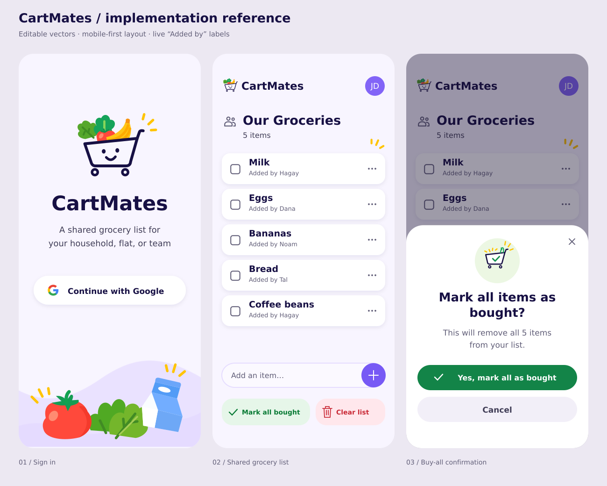

# CartMates

CartMates is a small, open-source shared grocery list for families, flatmates, and teams. Everyone
approved for one deployment sees the same list, can add or remove items, and can mark one item or the
whole list bought. Every item shows who added it. The experience is designed first for a phone in a
grocery store: quick, clear, accessible, and pleasantly lightweight.



## What it includes

- Google OpenID Connect sign-in with an exact, deployment-managed email allowlist
- One shared list and one group per deployment
- Add, buy, remove, clear, and mark-all-bought actions
- Immutable `Added by …` attribution derived from the authenticated session
- Stable IDs for duplicate item names
- Serialized, atomic, durable, and retry-safe mutations
- Automatic conditional polling so active members converge within a few seconds
- Responsive phone, tablet, and desktop layouts with WCAG 2.2 AA-oriented behavior
- Cloudflare Pages, Pages Functions, a private Worker, and one Durable Object
- Strict TypeScript, focused automated tests, bundle/secret guards, and GitHub Actions

The MVP intentionally has no roles, invitations, multiple groups, quantities, categories, prices,
history, notifications, offline editing, analytics, advertising, or AI features.

## High-level design

```text
Browser
  | same-origin HTTPS + secure session cookie
  v
Cloudflare Pages
  |-- Vite/React static application
  `-- Pages Functions: OIDC, session, allowlist, CSRF, validation, JSON API
           | private typed Durable Object binding
           v
      SharedList Durable Object
           | one serialized mutation boundary
           `-- SQLite-backed synchronous KV storage
                 |-- state/document: human-readable NDJSON active list
                 `-- operation/*: content-free idempotency receipts
```

Cloudflare requires new Durable Object namespaces to use SQLite backing. CartMates does not use a
relational model, SQL tables, or an ORM. It uses the storage engine's transactional key-value API to
persist one readable NDJSON document and small retry receipts. One named Durable Object,
`shared-list-v1`, is the authoritative coordinator for the deployment.

The browser never writes storage directly. Every protected API request revalidates the encrypted
session and current allowlist. Every mutation additionally verifies Origin, CSRF, input, and a UUID
idempotency key. A mutation returns the full authoritative list only after list state and receipt
commit together.

More detail is in [the architecture guide](docs/architecture.md) and
[security and privacy guide](docs/security-and-privacy.md).

## Repository structure

| Path | Purpose |
|---|---|
| `src/` | React application, plain CSS, API client, and polling state |
| `functions/` | Same-origin Cloudflare Pages Functions and security boundary |
| `state-worker/` | Private `SharedList` Durable Object and atomic persistence |
| `shared/` | Safe wire types, validation, list transitions, and NDJSON codec |
| `public/assets/` | Approved runtime-ready CartMates artwork and icons |
| `tests/` | Unit, component, Worker, contract, browser, accessibility, and visual tests |
| `specs/001-shared-grocery-list/` | Constitution-driven specification, plan, contracts, and tasks |

## Prerequisites

- Node.js 24 LTS and npm
- A Cloudflare account with Pages, Workers, and Durable Objects
- Wrangler authenticated for deployment
- A Google OAuth web application client

The repository declares Node `>=24 <26`. Newer local Node releases may work, but CI uses Node 24.

## Install and build

```sh
npm ci
npm run typecheck
npm run build
```

The production build lands in `dist/`. Building also enforces the 150 KiB gzip initial-JavaScript
budget. To run every local quality check:

```sh
npm run lint
npm run typecheck
npm run test
npm run test:workers
npm run build
npm run check:secrets
npm run test:e2e
```

Browser tests require Chromium once per machine:

```sh
npx playwright install chromium
```

## Configuration

Copy the secret-free example for local development:

```sh
cp .dev.vars.example .dev.vars
```

| Variable | Secret | Meaning |
|---|---:|---|
| `APP_ORIGIN` | No | Exact origin, such as `http://localhost:8788` or your production HTTPS origin |
| `GROUP_DISPLAY_NAME` | No | Group heading; defaults to `Our Groceries` |
| `GOOGLE_CLIENT_ID` | No | Google OAuth web client ID |
| `GOOGLE_CLIENT_SECRET` | Yes | Google OAuth client secret |
| `ALLOWED_EMAILS` | Yes | Comma-separated exact email allowlist |
| `SESSION_ENCRYPTION_KEY` | Yes | 32 random bytes encoded as base64url |

Generate a session key with a trusted local secret generator. Never place the real value in source,
client-prefixed variables, screenshots, logs, issues, or pull requests. Production secrets belong in
Cloudflare encrypted secrets. Register this callback with Google:

```text
${APP_ORIGIN}/api/auth/callback
```

Google must provide a verified email and non-empty display name. CartMates discards provider tokens
after verifying the ID token because it calls no Google APIs.

## Local development

Pages and a Durable Object class are separate Cloudflare deployment units, so use two terminals.

```sh
# Terminal 1: private state Worker
npm run dev:state

# Terminal 2: after creating an initial build
npm run build
npm run dev:pages
```

Open `http://localhost:8788`. Keep both processes running. When changing browser code, `npm run dev`
offers the fastest UI-only loop, while `dev:pages` exercises Pages Functions and bindings.

Do not use production identities or data in automated tests. The Worker suite uses isolated local
Durable Object storage; browser tests use deterministic API fixtures.

### Local Wrangler troubleshooting

If Wrangler reports `Unable to fetch the Request.cf object` followed by a self-signed certificate
warning but then prints `Ready`, local execution is still available; Wrangler is using placeholder
Cloudflare request metadata. On an enterprise/VPN network, Node 24.6+ can trust macOS or Windows
system certificates when the processes are started with:

```sh
export NODE_USE_SYSTEM_CA=1
```

Alternatively, point `NODE_EXTRA_CA_CERTS` at an approved PEM CA bundle. Do not disable TLS
verification with `NODE_TLS_REJECT_UNAUTHORIZED=0`.

If `/api/auth/login` returns `500`, verify that `SESSION_ENCRYPTION_KEY` decodes to exactly 32 bytes.
Generate a valid base64url value with:

```sh
openssl rand -base64 32 | tr '+/' '-_' | tr -d '='
```

## Testing strategy

- **Vitest** verifies validation, NDJSON, pure transitions, retry keys, and React components.
- **Cloudflare Vitest integration** runs contract and Durable Object tests in `workerd`, including
  100-operation race/retry trials and restart persistence.
- **Playwright** verifies phone/desktop interaction, keyboard behavior, axe checks, responsive
  layouts, collaboration, network recovery, performance, and reviewed app-only snapshots.
- **Manual validation** covers screen readers, touch, zoom/reflow, virtual keyboards, and reduced
  motion where automation is insufficient.

Tests protect behavior rather than an arbitrary coverage percentage.

## Deploying to Cloudflare

1. Create production and preview resources separately.
2. Set public variables and encrypted secrets in Cloudflare.
3. Deploy the private state Worker first:

   ```sh
   npm run deploy:state -- --env production
   ```

4. Ensure the Pages `LIST` binding targets `SharedList` in `cartmates-state`.
5. Build and deploy Pages:

   ```sh
   npm run build
   npm run deploy:pages
   ```

6. Attach your custom domain and register its exact callback with Google.
7. Run the checks in [the deployment smoke test](docs/deployment-smoke-test.md).

The initial public domain is `shopping.lupesko.com`, but no reusable application logic hardcodes it.
Forks use the same documented path with their own origin, Google client, allowlist, Cloudflare account,
and namespace. Rollback deploys a known-good Worker and Pages build without deleting or replacing the
Durable Object namespace.

Preview deployment uses the isolated `cartmates-state-preview` Worker/namespace and a non-main
Pages branch; production uses `cartmates-state-production` and `main`. The manual Deploy workflow
selects one target explicitly, while successful CI on `main` deploys production. Secrets are scoped
to the corresponding GitHub environment.

## Stored information and privacy

CartMates stores only:

- encrypted short-lived session claims needed for access and attribution;
- current active item ID, text, and immutable creator display name; and
- operation kind, fingerprint, outcome, and revision for retry safety.

It stores no bought-item history, profiles, behavioral analytics, advertising identifiers, or
tracking data. Logs omit tokens, codes, emails, names, allowlists, item content, and list state.
Self-hosted instances operate independently and share no application data with another instance.

## Contributing

Read [CONTRIBUTING.md](CONTRIBUTING.md) and the [Code of Conduct](CODE_OF_CONDUCT.md). Changes must
trace to an approved requirement, remain small, add focused tests, and pass lint, strict typecheck,
tests, accessibility checks, and production build. CartMates uses the [MIT License](LICENSE).
