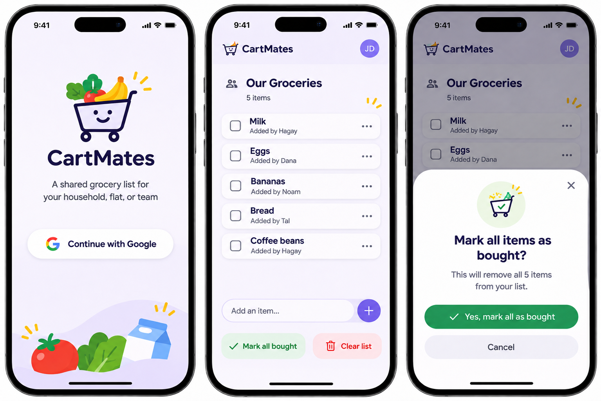

# Feature Specification: Shared Grocery List

**Feature Branch**: Not created (no branch hook configured)

**Created**: 2026-11-05

**Last Updated**: 2026-11-06

**Status**: Draft

**Input**: User description: "Build CartMates as a simple, secure, delightful, collaborative grocery
shopping list for one allowlisted group per deployment, with immutable creator attribution on every
item and the supplied CartMates mockup and visual asset pack as the approved design baseline."

## Visual Design Reference

The supplied three-screen mockup establishes the intended visual direction for the sign-in screen,
active shopping list, and Mark All as Bought confirmation. It demonstrates the product's pale
lavender canvas, deep navy typography, rounded white item cards, purple add action, green completion
action, red clear action, friendly grocery illustrations, and visually secondary creator labels.

Supporting references:

- [Responsive mobile screen reference](assets/cartmates-ui-assets/design/mobile-screens.png)
- [Visual asset contact sheet](assets/cartmates-ui-assets/design/asset-contact-sheet.png)
- [Static composition preview](assets/cartmates-ui-assets/design/preview.html)
- [Suggested visual tokens](assets/cartmates-ui-assets/design/tokens.css)
- [Asset pack guide](assets/cartmates-ui-assets/README.md)
- [Asset manifest](assets/cartmates-ui-assets/asset-manifest.json)
- [Implementation handoff](assets/cartmates-ui-assets/CODEX-HANDOFF.md)
- [Runtime-ready visual assets](assets/cartmates-ui-assets/public/assets/)

The mockup is a design reference, not a flattened implementation or a source of sample production
data. Functional requirements, accessibility, responsive behavior, dynamic content, and the
constitution take precedence wherever a static composition cannot demonstrate them. The device
frame, camera cutout, status bar, connectivity indicators, and home indicator belong to the mockup
presentation and MUST NOT be rendered by the web application.

## User Scenarios & Testing *(mandatory)*

### User Story 1 - Sign In with Google (Priority: P1)

As a visitor, I want to sign in with my Google account so that I can securely access the shared
shopping list when my email address has been approved by the instance administrator.

**Why this priority**: Every shopping-list operation depends on establishing who the visitor is and
whether that person belongs to the configured group.

**Independent Test**: Configure one approved and one unapproved email address, attempt sign-in with
each account, refresh the approved session, sign out, and verify that protected list actions are
available only to the approved account.

**Acceptance Scenarios**:

1. **Given** a visitor whose Google email address is allowlisted, **When** the visitor completes
   sign-in, **Then** the shared shopping list is displayed.
2. **Given** a visitor whose Google email address is not allowlisted, **When** the visitor completes
   sign-in, **Then** a friendly access-denied message is shown and no list data is disclosed.
3. **Given** an authorized signed-in member, **When** the page is refreshed, **Then** the member
   remains signed in and can continue using the list.
4. **Given** an authorized signed-in member, **When** the member signs out, **Then** protected list
   data and operations are no longer accessible in that session.
5. **Given** an unauthenticated or unauthorized request, **When** any list operation is attempted,
   **Then** the operation is rejected without revealing list contents.

---

### User Story 2 - View the Shared List (Priority: P1)

As an authorized member, I want to see the group's current shopping list so that I know what remains
to be bought and can trust that I am seeing the same state as everyone else.

**Why this priority**: A shared, persistent view is the core value of CartMates and is required before
members can collaborate meaningfully.

**Independent Test**: Open the same configured instance as two authorized members, verify identical
items and remaining count, change the list in one session, and confirm the other session updates
automatically without a manual refresh.

**Acceptance Scenarios**:

1. **Given** two authorized members using separate devices, **When** both open CartMates, **Then**
   both see the same active items and remaining-item count.
2. **Given** an empty shared list, **When** an authorized member opens CartMates, **Then** a friendly
   empty state and a remaining count of zero are shown.
3. **Given** a change successfully made by another member, **When** the viewer remains on the list
   with normal connectivity, **Then** the updated list becomes visible within five seconds without
   manual refresh.
4. **Given** previously saved items, **When** a member returns in a later browser session or after an
   application restart, **Then** the current list remains intact.

---

### User Story 3 - Add Items (Priority: P1)

As an authorized member, I want to add a grocery item quickly so that the group knows it still needs
to be purchased.

**Why this priority**: Adding items is one of the two most frequent actions and creates the shared
content that makes the product useful.

**Independent Test**: Submit valid and invalid item names by keyboard and touch, including duplicate
names and boundary lengths, and verify the resulting list, feedback, and input state.

**Acceptance Scenarios**:

1. **Given** an authorized member has entered `Milk`, **When** the member presses Enter or taps Add,
   **Then** one `Milk` item appears with that member's creator label, the remaining count increases
   by one, and the input clears after successful confirmation.
2. **Given** an item name with leading or trailing whitespace, **When** it is submitted, **Then** the
   whitespace is trimmed before the item is saved.
3. **Given** an empty or whitespace-only item name, **When** it is submitted, **Then** no item is
   added and clear corrective feedback is shown.
4. **Given** an item name containing a line break or more than 200 characters, **When** it is
   submitted, **Then** no item is added and the applicable validation message is shown.
5. **Given** `Eggs` already appears on the list, **When** a member adds `Eggs` again, **Then** a second,
   independently actionable `Eggs` item appears.

---

### User Story 4 - See Who Added Each Item (Priority: P1)

As an authorized member, I want each item to show who originally added it so that the group has
lightweight context without introducing ownership rules or a user-management system.

**Why this priority**: Creator context is required for every item and must remain correct through
concurrent activity, later interactions, and restarts without weakening equal group permissions.

**Independent Test**: Have two authorized members add unique and duplicate item names concurrently,
verify each item displays the correct authenticated creator, restart the application, and confirm
the labels remain correct while either member can still buy or remove either item.

**Acceptance Scenarios**:

1. **Given** Hagay is authenticated, **When** Hagay adds `Milk`, **Then** all authorized viewers see
   `Milk` with the secondary label `Added by Hagay` beneath it.
2. **Given** another authenticated member adds `Eggs`, **When** the shared list updates, **Then** all
   authorized viewers see that member's authenticated display name beneath `Eggs`.
3. **Given** an item added by one member, **When** Hagay marks it as bought, **Then** the item is
   removed normally even though Hagay is not its creator.
4. **Given** two authenticated members, **When** they add different items simultaneously, **Then**
   each item retains the display name of the member who submitted that addition.
5. **Given** attributed items have been saved, **When** the application restarts, **Then** every
   remaining item retains its original creator label.
6. **Given** two members add identical item text, **When** the list is displayed and either item is
   removed, **Then** each occurrence shows its own correct creator and remains independently
   actionable.

---

### User Story 5 - Mark One Item as Bought (Priority: P1)

As an authorized shopper, I want to mark a specific item as bought with one comfortable touch so
that the active list immediately reflects what remains.

**Why this priority**: Buying individual items is the primary in-store action and must be fast while
preserving the identity of duplicate entries.

**Independent Test**: Create two items with the same text, mark one as bought, and verify that only
the selected occurrence is removed after successful confirmation and no history is retained.

**Acceptance Scenarios**:

1. **Given** an active item, **When** a member activates its bought control and the change succeeds,
   **Then** that item is removed from the active list and the remaining count decreases by one.
2. **Given** two items with identical text, **When** one occurrence is marked bought, **Then** only
   the selected occurrence is removed.
3. **Given** an item is marked bought, **When** the resulting state is viewed, **Then** no bought-item
   history is available.

---

### User Story 6 - Remove One Item (Priority: P1)

As an authorized member, I want to remove a specific item that is no longer needed so that the
shared list stays accurate.

**Why this priority**: Members need a direct correction mechanism distinct from recording a purchase.

**Independent Test**: Remove a selected item from a list containing unique and duplicate names, then
repeat the request after another member has already removed it and verify that no other item changes.

**Acceptance Scenarios**:

1. **Given** an active item, **When** a member uses its Remove action successfully, **Then** only that
   selected item is removed for all members.
2. **Given** two items with identical text, **When** one is removed, **Then** the other remains.
3. **Given** another member already removed the selected item, **When** a stale removal is attempted,
   **Then** no different item is removed and the current list remains correct.

---

### User Story 7 - Clear the Entire List (Priority: P1)

As an authorized member, I want to clear the entire list after confirmation so that I can reset the
group's active shopping needs without removing items one by one.

**Why this priority**: A safe list-wide reset is required for the stated MVP and must not expose
partial results.

**Independent Test**: Clear a populated list, cancel the confirmation once, confirm it once, and
repeat on an empty list while verifying the operation is all-or-nothing.

**Acceptance Scenarios**:

1. **Given** a populated list, **When** a member initiates Clear and cancels confirmation, **Then** no
   items are removed.
2. **Given** a populated list, **When** a member confirms Clear and it succeeds, **Then** every item is
   removed in one operation and the empty state is shown.
3. **Given** an already-empty list, **When** a member confirms Clear, **Then** the list remains empty
   without an error or unintended side effect.

---

### User Story 8 - Mark All Items as Bought (Priority: P1)

As an authorized shopper, I want to mark the entire list as bought after confirmation so that the
active list can reflect completion of a shopping trip.

**Why this priority**: The requested MVP includes a semantically clear completion action even though
its resulting list state matches Clear.

**Independent Test**: Invoke Mark All as Bought on a populated list, cancel and then confirm it, and
verify that all items disappear atomically without creating purchase history.

**Acceptance Scenarios**:

1. **Given** a populated list, **When** a member initiates Mark All as Bought and cancels
   confirmation, **Then** the list is unchanged.
2. **Given** a populated list, **When** a member confirms Mark All as Bought and it succeeds, **Then**
   all items are removed in one operation and no purchase history is retained.
3. **Given** an empty list, **When** Mark All as Bought is confirmed, **Then** the operation completes
   safely and the list remains empty.

---

### User Story 9 - Collaborate Concurrently (Priority: P1)

As an authorized member, I want simultaneous changes from group members to resolve predictably so
that no successfully saved shopping-list update is lost.

**Why this priority**: Collaboration is the defining product behavior; incorrect concurrent updates
would make the shared list untrustworthy.

**Independent Test**: Run simultaneous adds, item removals, and list-wide actions from separate
sessions, then verify every confirmed result follows one authoritative operation order and all
members converge on that state.

**Acceptance Scenarios**:

1. **Given** two authorized members, **When** they add different items at approximately the same
   time, **Then** both successfully confirmed items remain on the shared list with the correct
   creator attribution.
2. **Given** one member clears the list while another adds an item, **When** both operations complete,
   **Then** the final state reflects their authoritative serialized order and does not lose a
   successfully committed addition that occurred after the clear.
3. **Given** two members act on the same item, **When** their requests are resolved, **Then** no
   unrelated item is changed and both members eventually see the authoritative result.
4. **Given** a successfully confirmed mutation, **When** the application restarts before another
   member next views the list, **Then** the mutation remains present in the authoritative state.

---

### User Story 10 - Shop with a Mobile-Friendly Experience (Priority: P1)

As a shopper using a phone, I want a delightful, accessible interface with effortless common actions
so that I can manage the list quickly with touch while moving through a store.

**Why this priority**: The primary usage context is mobile shopping, where small targets, clutter,
slow feedback, or inaccessible controls would prevent successful use of otherwise correct features.

**Independent Test**: Complete sign-in, view, add, buy, remove, and list-wide tasks on a phone-sized
viewport using touch, then repeat all controls with a keyboard and a representative screen reader.

**Acceptance Scenarios**:

1. **Given** an authorized member on a typical phone, **When** the member adds an item and marks it
   bought using touch alone, **Then** both tasks are easy to discover and complete without opening
   extra menus or screens.
2. **Given** an operation is in progress, succeeds, fails, or finds no data, **When** the interface
   presents the state, **Then** feedback is immediate, clear, friendly, and accessible.
3. **Given** a keyboard or screen-reader user, **When** the user navigates and activates every core
   control, **Then** the same list functionality is available with meaningful names and state.
4. **Given** a desktop browser, **When** an authorized member uses CartMates, **Then** the interface
   remains readable and fully functional.
5. **Given** reduced-motion preferences, **When** state changes occur, **Then** nonessential motion is
   suppressed without hiding feedback.
6. **Given** a signed-out visitor on a phone-sized viewport, **When** the sign-in screen appears,
   **Then** it follows the supplied reference's brand hierarchy with the CartMates illustration,
   product name, concise purpose statement, prominent Google sign-in action, and decorative grocery
   artwork without content overlap.
7. **Given** an authorized member with active items, **When** the list screen appears, **Then** it
   follows the supplied reference's hierarchy for brand header, member identity, group name, count,
   item cards, creator labels, add controls, and list-wide actions while displaying live data.
8. **Given** an authorized member initiates Mark All as Bought, **When** confirmation is required,
   **Then** an accessible bottom-sheet-style confirmation follows the supplied visual reference and
   presents the live item count, confirm, cancel, and close actions.

---

### User Story 11 - Configure One Group (Priority: P2)

As an instance administrator, I want to configure the approved members and a group display name so
that one deployment represents one household, flat, or office without in-app administration.

**Why this priority**: Group identity improves personalization and self-hosting, but the core list can
still be demonstrated with a default name and preconfigured members.

**Independent Test**: Configure a display name and allowlist before launch, verify all approved
members see that name and share one list with equal permissions, and verify the documented default.

**Acceptance Scenarios**:

1. **Given** no custom display name, **When** an authorized member opens CartMates, **Then** the group
   name is shown as `Our Groceries`.
2. **Given** a custom display name, **When** any authorized member opens CartMates, **Then** that name
   is shown consistently.
3. **Given** multiple allowlisted members, **When** they use the same deployed instance, **Then** they
   share one list and have identical permissions.
4. **Given** an authorized member, **When** the member uses the application, **Then** no in-app group,
   invitation, role, or membership administration controls are offered.

### Edge Cases

- An item containing only spaces becomes empty after trimming and is rejected.
- An item of exactly 200 characters is accepted; an item of 201 characters is rejected.
- Any carriage return or line-feed character in an item is rejected rather than split into multiple
  items.
- Duplicate names remain separate items, even after intervening additions or automatic list refreshes.
- Identical item text is added by different members; each occurrence retains its own creator label
  and unique identity.
- A member's Google display name changes after an item was added; the existing item retains the
  original creator name captured when it was created.
- A client attempts to submit or alter a creator name; the supplied value is not trusted and cannot
  override the identity derived from the authenticated session.
- An authenticated Google account does not provide a usable display name; the item is not added with
  fabricated or client-supplied attribution, and the member receives actionable feedback.
- A creator name is long or contains non-Latin characters; the secondary label remains readable,
  accessible, and visually subordinate without changing the stored name.
- A phone viewport is short or the on-screen keyboard is open; primary controls remain reachable,
  list content can scroll, and decorative artwork does not cover interactive content.
- Item text, creator names, or the group name are longer than the mockup samples; live content wraps
  or truncates accessibly without overlapping controls or hiding essential meaning.
- The viewport includes safe-area insets or expands to tablet and desktop widths; the layout adapts
  without reproducing the mockup's phone frame or relying on fixed screenshot coordinates.
- A supplied decorative asset cannot be displayed; the core task and accessible name remain usable
  without depending on the image to communicate required information.
- The Google identity mark is displayed; its proportions and colors remain unmodified and applicable
  identity-provider branding requirements take precedence over the illustrative mockup.
- A stale buy or remove action targets an item another member already removed; no remaining item is
  changed by position or matching text.
- Clear or Mark All as Bought races with an add or single-item action; the final list reflects one
  authoritative operation order.
- A client retries after losing the response to a successful mutation; the mutation is not applied
  destructively a second time.
- A member's session expires while a mutation is in progress; protected data is not disclosed, no
  false success is shown, and the member is guided to sign in again.
- Connectivity is lost before, during, or after an operation; the interface distinguishes pending,
  confirmed, and failed outcomes and reconciles with the authoritative list when connectivity returns.
- An unauthorized user attempts to call a protected operation directly; the request is rejected and
  no list content, allowlist content, or sensitive diagnostic detail is returned.
- An empty list receives Clear or Mark All as Bought repeatedly; it remains safely empty.
- The list changes while a destructive confirmation is open; the confirmed list-wide operation is
  applied according to its authoritative serialized order, not an obsolete client snapshot.
- Item text contains non-Latin characters, emoji, or punctuation; valid single-line text remains
  distinguishable and readable.

## Requirements *(mandatory)*

### Functional Requirements

#### Authentication and Authorization

- **FR-001**: The product MUST allow visitors to authenticate with a Google account.
- **FR-002**: The product MUST authorize access only when the authenticated email address exactly
  matches an address in the administrator-controlled static allowlist.
- **FR-003**: Every operation that reads or changes shopping-list data MUST require current
  authentication and allowlist authorization.
- **FR-004**: Unauthorized visitors MUST receive a friendly access-denied outcome without seeing
  shopping-list data or sensitive configuration.
- **FR-005**: An authorized member's session MUST survive ordinary page refreshes.
- **FR-006**: Authorized members MUST be able to sign out, after which protected data and operations
  MUST be inaccessible from that session.
- **FR-007**: All authorized members MUST have identical list permissions; the MVP MUST NOT define
  roles or per-member permissions.
- **FR-008**: The product MUST collect and retain no identity information beyond what is necessary to
  authenticate, authorize, and preserve required item-creator attribution.

#### Shared List Viewing and Synchronization

- **FR-009**: Each deployed instance MUST expose exactly one shared active shopping list to all
  authorized members.
- **FR-010**: The active list MUST display every current item as a readable text entry.
- **FR-011**: The product MUST display an accurate count of active items remaining.
- **FR-012**: An empty active list MUST display a friendly empty state and a count of zero.
- **FR-013**: Under normal connectivity, successfully committed changes from another member MUST
  become visible to an active viewer automatically within five seconds without manual refresh.
- **FR-014**: The authoritative list MUST persist across browser sessions, service restarts, and
  deployments.

#### Item Addition and Identity

- **FR-015**: An authorized member MUST be able to submit an item by pressing Enter or activating an
  Add control.
- **FR-016**: Item names MUST be accepted as free-form, single-line text up to 200 characters.
- **FR-017**: Leading and trailing whitespace MUST be removed before validation and storage.
- **FR-018**: Empty, whitespace-only, multiline, and overlength item names MUST be rejected with
  clear corrective feedback.
- **FR-019**: Duplicate item names MUST be allowed.
- **FR-020**: Every item occurrence MUST remain individually distinguishable so an operation on one
  duplicate cannot affect another duplicate.
- **FR-021**: After a successful addition, the submitted item MUST appear in the shared list and the
  add-item input MUST clear.
- **FR-022**: A failed addition MUST NOT clear the member's valid input before the member can retry or
  correct it.

#### Item and List Mutations

- **FR-023**: Each item MUST provide a touch-friendly and accessible control for marking that item as
  bought.
- **FR-024**: Successfully marking an item as bought MUST remove only that item from the active list.
- **FR-025**: Each item MUST provide a distinct Remove action that deletes only that item.
- **FR-026**: Buying or removing an item MUST NOT retain purchase history or a recoverable item
  archive in the MVP.
- **FR-027**: An authorized member MUST be able to initiate Clear List and Mark All as Bought.
- **FR-028**: Clear List and Mark All as Bought MUST each require explicit confirmation before any
  items are removed.
- **FR-029**: A confirmed Clear List or Mark All as Bought operation MUST remove all then-active items
  atomically and produce the same empty-list state.
- **FR-030**: Clear List and Mark All as Bought MUST be safe when the list is already empty.
- **FR-031**: A mutation targeting an item already removed by another operation MUST NOT alter any
  other item.

#### Collaboration and Correctness

- **FR-032**: The backend-held list state MUST be authoritative for every member and device.
- **FR-033**: All mutations to the shared list MUST be resolved in one definitive serialized order.
- **FR-034**: No successfully confirmed update MAY be lost when operations overlap.
- **FR-035**: Every successful mutation MUST be durably saved before success is communicated.
- **FR-036**: Repeated delivery or retry of the same mutation MUST NOT repeat a destructive effect.
- **FR-037**: After concurrent activity settles and connectivity is available, all active authorized
  members MUST converge on the same list state.
- **FR-038**: Pending, successful, failed, and uncertain operation outcomes MUST be distinguishable to
  the member; the product MUST NOT report success before durable confirmation.

#### Group Configuration

- **FR-039**: One deployed instance MUST represent one household, flat, office, or other group.
- **FR-040**: The instance administrator MUST be able to configure the approved email allowlist
  outside the member-facing application.
- **FR-041**: The instance administrator MUST be able to configure a group display name outside the
  member-facing application.
- **FR-042**: The default group display name MUST be `Our Groceries`.
- **FR-043**: The MVP MUST NOT expose in-app group creation, membership, invitation, registration,
  role, or administration workflows.

#### Experience and Accessibility

- **FR-044**: The primary interface MUST be optimized for phone-sized touchscreens and remain usable
  on tablets and desktop browsers.
- **FR-045**: Adding and buying an item MUST be available directly from the primary list view without
  unnecessary menus or navigation.
- **FR-046**: Interactive targets MUST be large enough for comfortable touch use and MUST have clear
  visible, focus, disabled, pending, success, and error states as applicable.
- **FR-047**: The interface MUST provide friendly and accessible loading, empty, success, validation,
  connectivity, authorization, and unexpected-error states.
- **FR-048**: Every core action MUST be operable by keyboard and exposed with meaningful names,
  roles, values, and state for screen-reader users.
- **FR-049**: User-facing functionality MUST satisfy WCAG 2.2 AA expectations.
- **FR-050**: Motion MUST be subtle, purposeful, non-blocking, and reduced when the member expresses
  a reduced-motion preference.
- **FR-051**: The product MUST provide immediate acknowledgment of user input and visible feedback
  while an operation awaits authoritative confirmation.
- **FR-052**: Core list use MUST remain responsive on typical mobile devices and slower mobile
  connections.

#### Open-Source and Deployment Deliverables

- **FR-053**: The source distribution MUST use the MIT License and be publishable in a public source
  repository without application data, credentials, tokens, or secrets.
- **FR-054**: `README.md` MUST explain purpose, features, architecture, screenshots, installation,
  configuration, local development, testing, deployment, stored information, and self-hosting.
- **FR-055**: `CONTRIBUTING.md` MUST explain issue reporting, feature requests, local setup, project
  conventions, quality checks, documentation and test expectations, and change review.
- **FR-056**: `CODE_OF_CONDUCT.md` MUST define community conduct expectations, and the public project
  MUST include secret-free example configuration.
- **FR-057**: The application MUST be straightforward to fork, customize, and operate as an
  independent instance.
- **FR-058**: The initial production instance MUST be deployable at `shopping.lupesko.com` without
  coupling reusable product behavior to that domain.
- **FR-059**: The deployment deliverable MUST support the project's mandated Cloudflare Pages target
  and MUST remain reproducible from the public repository.
- **FR-060**: Automated project checks MUST verify linting, type correctness, core behavior, and a
  production-ready build before changes are accepted.

#### Item Creator Attribution

- **FR-061**: Every grocery item MUST contain a unique identifier, its grocery-item text, and the
  display name of the member who originally added it.
- **FR-062**: When an item is added, the creator display name MUST be obtained from the authenticated
  Google session on the trusted server side; client input MUST NOT supply or override it.
- **FR-063**: The creator display name MUST be assigned when the item is created and MUST remain
  unchanged if the member later changes their account name or another member interacts with the item.
- **FR-064**: Every authorized viewer MUST see the creator beneath the item text in the format
  `Added by {display name}`.
- **FR-065**: The creator label MUST use visually secondary, smaller, muted styling while remaining
  readable, accessible, and compatible with the mobile-first layout.
- **FR-066**: Creator attribution MUST be durably preserved across sessions, service restarts, and
  deployments for as long as the item remains active.
- **FR-067**: Simultaneous additions by different members MUST bind each new item to the correct
  authenticated creator without mixing, overwriting, or losing attribution.
- **FR-068**: Creator attribution MUST NOT confer ownership or special permissions; every authorized
  member MUST retain equal ability to buy, remove, or clear items regardless of creator.
- **FR-069**: Creator attribution MUST use the authenticated Google display name without adding
  editable profiles, member directories, roles, or other user-management features.
- **FR-070**: Attribution MUST be representable in a simple, lightweight, human-readable item record;
  the product MUST NOT require a database solely to store creator attribution.

#### Visual Direction and Assets

- **FR-071**: The sign-in, active-list, and Mark All as Bought confirmation experiences MUST follow
  the supplied mockup's visual hierarchy, palette, rounded forms, spacing character, and friendly
  grocery-themed brand direction while satisfying all functional and accessibility requirements.
- **FR-072**: Branded illustrations, marks, interface icons, app icons, and decorative backgrounds
  represented in the approved experience MUST use the supplied CartMates asset pack where a matching
  asset exists.
- **FR-073**: Grocery names, creator labels, group names, member initials, item counts, button labels,
  error messages, and confirmation copy MUST remain live content rather than text embedded in images.
- **FR-074**: The original phone frame, camera cutout, operating-system status indicators, and home
  indicator MUST NOT be reproduced in the web application.
- **FR-075**: The sign-in experience MUST include the CartMates brand illustration and name, a concise
  purpose statement, a prominent Google sign-in action, and decorative grocery artwork arranged so
  that short viewports and safe areas do not cause overlap.
- **FR-076**: The active-list experience MUST present the brand header, signed-in member identity,
  group name, remaining count, item rows, creator labels, add controls, and list-wide actions in a
  clear hierarchy consistent with the supplied reference.
- **FR-077**: Mark All as Bought MUST use a modal confirmation presentation consistent with the
  supplied bottom-sheet reference, including the provided completion illustration, live item count,
  confirm action, cancel action, and close action. Clear List MUST use the same interaction pattern
  with action-appropriate content.
- **FR-078**: Visual compositions MUST adapt beyond the reference viewport without fixed screenshot
  coordinates, must keep primary content usable with the mobile keyboard open, and must respect
  device safe areas.
- **FR-079**: Illustrations and decorative graphics MUST NOT be the sole means of conveying required
  information; decorative assets MUST be ignored by assistive technology and meaningful imagery
  MUST have an appropriate text alternative.
- **FR-080**: CartMates artwork MAY be used under the included asset-pack license. Third-party marks,
  including Google's name and identity mark, MUST follow the applicable provider branding rules and
  MUST NOT be treated as CartMates-owned artwork.

### Key Entities

- **Authorized Member**: A person identified by a Google email address that appears in the static
  allowlist, with a display name supplied by the authenticated Google account. All authorized
  members have equal access to the instance's single shared list.
- **Member Session**: The signed-in state that lets an authorized member access protected data across
  ordinary page refreshes and that ends on sign-out or secure expiration.
- **Shopping List**: The single authoritative, durable collection of active grocery items for one
  deployed group, including its current remaining-item count.
- **Grocery Item**: One independently actionable record containing a unique identifier, free-form
  single-line item text, and an immutable snapshot of the creator's authenticated display name. Its
  identity distinguishes it from other occurrences even when their text is identical.
- **Group Configuration**: Administrator-provided instance settings containing the approved email
  allowlist and display name; it defaults to `Our Groceries` and is not edited in the product UI.
- **Mutation**: A requested add, buy, remove, clear, or mark-all action with a definitive outcome and
  an authoritative place in the serialized operation order.

### MVP Scope

The MVP includes:

- Google sign-in, static email-allowlist authorization, session continuity, and sign-out.
- One shared persistent list and one group per deployed instance.
- Add, buy, remove, clear, and mark-all-as-bought operations with duplicate-safe item identity and
  persistent, server-determined creator attribution.
- Serialized, atomic, durable, retry-safe collaboration and automatic refresh within five seconds.
- Configurable group display name with the `Our Groceries` default.
- A delightful mobile-first, responsive, accessible interface with complete user feedback states.
- The supplied CartMates visual direction and asset pack for sign-in, list, empty, feedback, and
  confirmation experiences, while keeping all product content live and accessible.
- Public MIT-licensed distribution, contributor and operator documentation, automated quality
  checks, reproducible deployment, and independent self-hosting.

### Explicitly Out of Scope

- Multiple groups within one deployed instance.
- Invitation, registration, in-app membership, or administration flows.
- An admin dashboard, user roles, or differentiated permissions.
- Categories, quantities, prices, budgets, assignments, or item metadata beyond the item text,
  unique identifier, and immutable creator display name.
- Purchase history, archives, undo history, or analytics.
- Notifications, offline editing, or native mobile applications.
- AI features, advertising, behavioral analytics, or third-party tracking.

## Success Criteria *(mandatory)*

### Measurable Outcomes

- **SC-001**: At least 90% of first-time authorized test participants can sign in, add an item, and
  mark it bought on a phone without assistance within two minutes.
- **SC-002**: At least 95% of test participants can identify the remaining-item count and complete
  Add, Buy, and Remove without navigating away from the primary list view.
- **SC-003**: Under normal connectivity, 95% of successfully confirmed changes become visible to a
  second active member within five seconds, and 100% become visible within ten seconds.
- **SC-004**: Across 100 automated simultaneous-operation trials covering two adds, add versus clear,
  and two actions on one item, no successfully confirmed update is lost and every final state matches
  a valid serialized order.
- **SC-005**: Across 20 restart and redeployment verification cycles, 100% of successfully confirmed
  list states remain intact.
- **SC-006**: In 100 retry trials for each destructive action, no retry removes an unintended item or
  applies the same destructive effect twice.
- **SC-007**: Unauthorized, signed-out, and non-allowlisted access attempts disclose no shopping-list
  data in 100% of authorization tests.
- **SC-008**: At least 95% of core user actions acknowledge input visibly within one second on a
  representative mobile device and connection, even when authoritative completion takes longer.
- **SC-009**: Every core task can be completed using only a keyboard and using a representative screen
  reader, with no WCAG 2.2 AA violations in the supported task flows.
- **SC-010**: A failed or interrupted network request never presents a false success state in the
  defined connectivity-failure acceptance tests, and recovery yields the authoritative list.
- **SC-011**: A new operator following only the public documentation can configure and launch an
  independent instance within 30 minutes after prerequisite accounts and domain access are ready.
- **SC-012**: A new contributor following only the public documentation can start the project, run
  all quality checks, and identify the main product boundaries within 30 minutes.
- **SC-013**: In a moderated usability review, at least 4 of 5 target users rate the mobile shopping
  flow as clear and pleasant and report no blocking confusion in the core tasks.
- **SC-014**: In 100% of attribution acceptance tests, every new item displays the authenticated
  creator's correct name to all authorized viewers, and no client-supplied creator value is accepted.
- **SC-015**: Across 100 simultaneous-addition trials and 20 restart verification cycles, every
  remaining item retains the correct original creator, including duplicate item names added by
  different members.
- **SC-016**: In a moderated mobile usability review, at least 4 of 5 target users can identify who
  added an item while rating the creator label as readable but not distracting from the item text.
- **SC-017**: In a visual acceptance review at the 390-by-844 reference viewport, all three supplied
  compositions are recognizable through their brand hierarchy, palette, key illustrations, control
  grouping, and confirmation treatment without reproducing device chrome.
- **SC-018**: At 320-pixel phone, 390-pixel reference, 768-pixel tablet, and 1440-pixel desktop
  viewport widths, every core action remains reachable with no clipped controls, overlapping live
  text, or decorative artwork blocking interaction.
- **SC-019**: In 100% of accessibility reviews, no required information depends solely on an image,
  every meaningful image has an appropriate text alternative, and decorative assets are omitted
  from the accessibility reading order.
- **SC-020**: At least 4 of 5 target users shown the implemented sign-in and list experiences describe
  them as visually cohesive, friendly, and easy to scan while completing the core tasks without
  assistance.

## Assumptions

- One deployment serves one trusted household, flat, office, or similar group; every allowlisted
  member intentionally receives equal list permissions.
- Instance administrators manage the allowlist and group display name through deployment
  configuration rather than through the member-facing product.
- Members have intermittent but generally available network connectivity. Offline editing is not
  supported; automatic reconciliation occurs after connectivity returns.
- Session continuity across refreshes does not mean indefinite access. Sessions may expire under a
  secure policy, after which the member signs in again.
- "Automatically within a few seconds" is defined as five seconds under normal connectivity for the
  MVP. Complex real-time presence and push delivery are not required.
- Item text may contain valid single-line Unicode text, including emoji and non-Latin scripts. Line
  breaks and unsafe control characters are rejected.
- The authenticated Google account is expected to provide a non-empty display name. If it does not,
  an item addition cannot succeed until trustworthy attribution is available; the client cannot
  provide a substitute creator name.
- A creator display name is stored as an immutable snapshot at item creation. Later changes to the
  member's Google display name apply only to items added after that change.
- Creator display names are part of protected shopping-list data and are visible only to authorized
  members of that deployed instance. They do not create a user profile or membership directory.
- The active list retains no bought-item or removal history. Operational safeguards needed to make a
  retry safe do not create a user-visible history.
- The MVP requires the simplest persistence model that preserves stable item identity, item text,
  immutable creator display name, serialization, atomic durability, and restart survival. A
  human-readable structured text record per item is acceptable when newline-delimited item names
  alone are insufficient; a relational data model is not a product requirement.
- Google identity availability is an external dependency for sign-in. Operators supply their own
  identity configuration, allowlist, deployment configuration, secrets, and domain access.
- Cloudflare Pages, the public source repository, the MIT License, Wrangler-compatible local
  development, and `shopping.lupesko.com` are mandated project constraints. Detailed technical
  design belongs to planning rather than this product specification.
- The supplied visual pack is the approved baseline for brand artwork and the three demonstrated
  compositions. Its suggested tokens and static preview guide implementation but do not override
  WCAG 2.2 AA, responsive behavior, live data, secure identity-provider requirements, or the
  functional specification.
